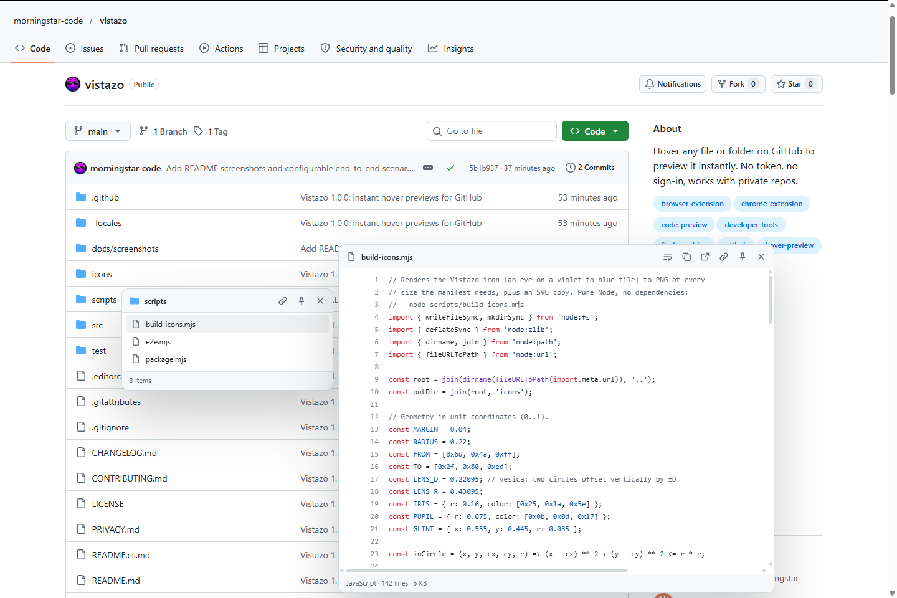

  

<h1 align="center">Vistazo</h1>

  <b>Pasa el cursor sobre cualquier archivo o carpeta de GitHub y mira qué hay dentro, al instante.</b> 
  Sin token. Sin iniciar sesión. Funciona con repos privados. Gratis.

<a href="README.md">Read in English</a>

Navegar un repositorio suele ser abrir un archivo, volver, abrir el siguiente, volver otra vez. Vistazo
elimina ese ciclo: deja el cursor sobre un enlace y aparece una vista previa justo al lado, con el mismo
estilo de GitHub.

## Funciones

- **Código** con resaltado de sintaxis para más de 45 lenguajes (incluido Lua), con los colores del tema
  de GitHub. Números de línea, ajuste de líneas, "ver más" o cargar el archivo completo.
- **Carpetas** como un mini explorador con filtro. Pasa el cursor sobre un elemento dentro de la vista
  previa para bajar un nivel, tantos niveles como quieras.
- **Markdown** renderizado como en GitHub: tablas, listas de tareas, avisos `> [!NOTE]`, imágenes y
  enlaces relativos. Los CSV se ven como tabla y el JSON minificado se formatea. Un clic vuelve al código.
- **Imágenes, video y audio** con dimensiones, cuadrícula de transparencia y zoom nítido para íconos
  pequeños.
- **Enlaces a líneas**: pasa el cursor sobre un enlace `…/archivo.js#L10-L20` en un issue o pull request
  y la vista previa salta a esas líneas y las resalta.
- **Fíjala**: haz clic dentro de una vista previa (o en el alfiler) para mantenerla abierta, arrástrala
  por el encabezado y cambia su tamaño desde la esquina. <kbd>Esc</kbd> cierra todo.
- **Acciones rápidas**: copiar el contenido, copiar la ruta, abrir el archivo sin formato.
- **Rápido con archivos enormes**: solo se descargan los primeros 256 KB, los resultados se guardan en
  caché y las solicitudes repetidas se unifican.
- **Igual que GitHub**: sigue automáticamente los temas claro, oscuro, atenuado y de alto contraste.
- **Privado**: sin cuenta, sin token, sin analíticas, sin servidores. El único permiso es `storage`,
  para tus ajustes.
- **Interfaz en español e inglés**, según el idioma del navegador.

## Instalación

1. Descarga `vistazo-<versión>.zip` de la [última versión](https://github.com/morningstar-code/vistazo/releases/latest) y descomprímelo.
2. Abre `chrome://extensions` (o `edge://extensions`, `brave://extensions`) y activa el **Modo de desarrollador**.
3. Haz clic en **Cargar descomprimida** y elige la carpeta descomprimida (la que tiene `manifest.json`).

**Firefox (experimental)**: abre `about:debugging#/runtime/this-firefox`, haz clic en **Cargar complemento
temporal** y elige `manifest.json`.

## Pruébala

Con la extensión instalada, abre la carpeta [`examples`](examples) de este repositorio y deja el cursor
sobre cualquier archivo: hay Lua, JSON, CSV, Markdown, una imagen y una carpeta anidada para probar.

## Uso

- Deja el cursor sobre cualquier enlace a un archivo o carpeta en github.com: la lista de archivos, el
  árbol lateral, READMEs, issues, pull requests, resultados de búsqueda.
- Dentro de una carpeta, pasa el cursor sobre un elemento para abrir el siguiente nivel. Escribe en el
  filtro para acotar la lista, <kbd>↓</kbd> para entrar en ella y <kbd>Enter</kbd> para abrir la primera
  coincidencia.
- Haz clic dentro de una vista previa para fijarla. <kbd>Esc</kbd> o un clic fuera la cierran.
- Haz clic en el ícono de la barra de herramientas para los ajustes: qué mostrar, retraso, tecla
  modificadora opcional, renderizado, números de línea, ajuste de líneas y líneas por página.

## ¿Por qué es mejor que peek-a-repo?

Vistazo se inspiró en [peek-a-repo](https://github.com/xevrion/peek-a-repo) de Yash Bavadiya, pero está
escrito desde cero y corrige lo que estorbaba:

| | peek-a-repo 3.0 | Vistazo |
|---|---|---|
| Configuración | Iniciar sesión con GitHub (OAuth) o pegar un token antes de que funcione | Nada. Instalar y listo |
| Repos privados | Requiere un token con acceso a repos privados | Usa la sesión de GitHub que ya tienes |
| Permisos | `storage`, `identity`, `alarms`, 3 permisos de host y un service worker | Solo `storage` |
| Red | API GraphQL (gasta tu límite). Al pasar sobre una carpeta descarga el texto de **todos** sus archivos | Solo el listado. Los archivos se piden al CDN al pasar el cursor, primeros 256 KB, sin cuota de API |
| Ramas con barra (`feature/login`) | Fallan: toma `feature` como rama | Funcionan |
| Enlaces a otros repos | Busca la ruta en el repo actual | Funcionan y muestran `dueño/repo` |
| Estilos | Inyecta CSS de Tailwind y Prism en todo GitHub | Aislados en un Shadow DOM |
| Tema | Siempre oscuro | Sigue tu tema de GitHub |
| Scroll de la página | Se bloquea mientras hay una vista previa | Nunca se toca |
| Código | 30 líneas, unos 12 lenguajes | 300 líneas por página (configurable), "ver más" y archivo completo, más de 45 lenguajes |
| Carpetas | Primeros 25 elementos | Hasta 400, con filtro |
| Markdown, CSV, JSON | Texto plano | Renderizados, con opción de ver el código |
| Video y audio | No | Sí |
| Enlaces a líneas (`#L10-L20`) | No | Resaltadas |
| Fijar, arrastrar, redimensionar, copiar | No | Sí |
| Datos no confiables | Los nombres de archivo se insertan como HTML | Solo nodos de texto; el Markdown pasa por un sanitizador con lista blanca |
| Navegadores | Chrome | Chrome, Edge, Brave, Opera; Firefox 140+ (experimental) |
| Idiomas | Inglés | Español e inglés |

## Privacidad

Vistazo no tiene servidores ni recopila nada. Solo se comunica con `github.com`,
`raw.githubusercontent.com` y, como respaldo, `api.github.com`, y únicamente para los enlaces sobre los
que pasas el cursor. Detalles en [PRIVACY.md](PRIVACY.md).

## Comentarios

¿Encontraste un error o tienes una idea? [Abre un issue](https://github.com/morningstar-code/vistazo/issues/new/choose).
Los problemas de seguridad van al [formulario privado](https://github.com/morningstar-code/vistazo/security/advisories/new).

## Licencia

Vistazo es gratis para descargar y usar. No es de código abierto: copiarlo, modificarlo o redistribuirlo
requiere permiso. Consulta [LICENSE](LICENSE). © 2026 [morningstar-code](https://github.com/morningstar-code)
