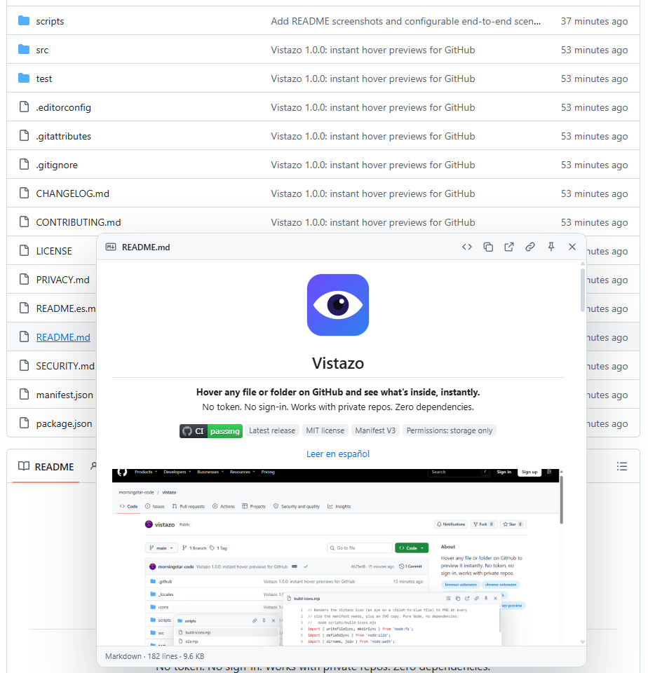
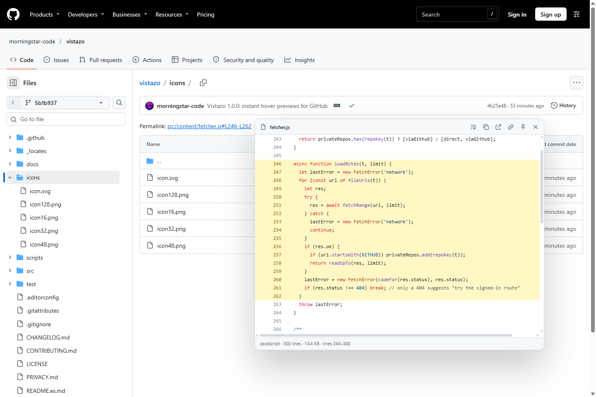
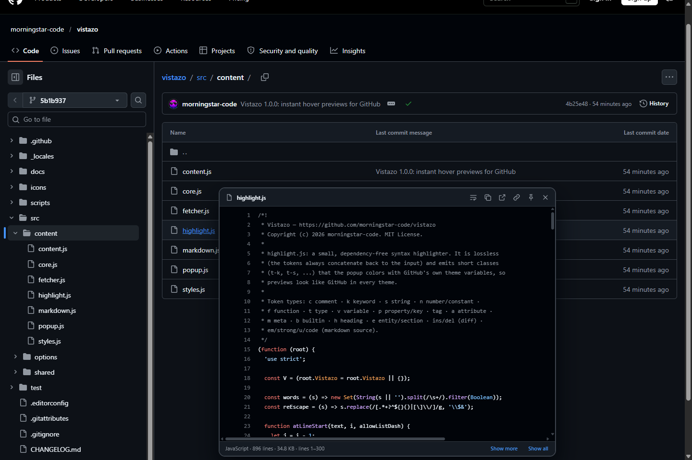
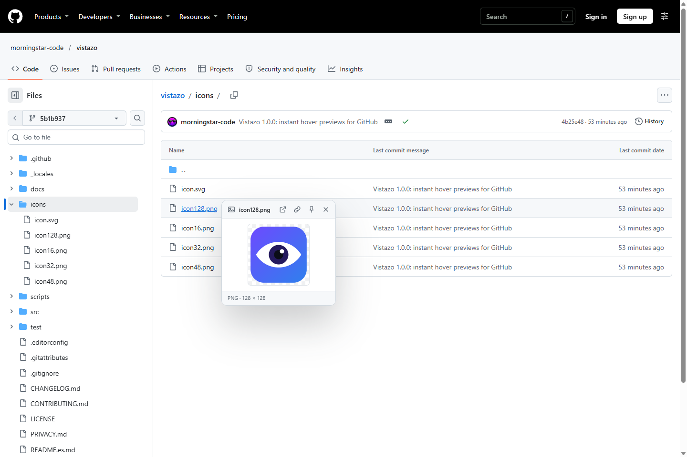

  

<h1 align="center">Vistazo</h1>

  <b>Hover any file or folder on GitHub and see what's inside, instantly.</b> 
  No token. No sign-in. Works with private repos. Free.

  
  
  
  

<a href="README.es.md">Leer en español</a>

_Vistazo_ is Spanish for "a quick look". Browsing a repository usually means open a file, go back, open
the next one, go back again. Vistazo removes that loop: rest the pointer on a link and a preview appears
right next to it, styled like GitHub itself.

## Features

- **Code** with syntax highlighting for 45+ languages, colored with GitHub's own theme. Line numbers,
  line wrapping, "show more", or load the full file.
- **Folders** as a mini file browser with a filter box. Hover an entry inside the preview to go one level
  deeper, as many levels as you like.
- **Markdown** rendered the GitHub way: tables, task lists, `> [!NOTE]` alerts, images, relative links.
  CSV files become tables and minified JSON gets formatted. One click switches back to the source.
- **Images, video and audio** with dimensions, a transparency grid and pixel-perfect zoom for tiny
  icons.
- **Line links**: hover a `…/file.js#L10-L20` link in an issue or pull request and the preview scrolls
  to those lines and highlights them.
- **Pin it**: click inside a preview (or on the pin) to keep it open, then drag it by its header and
  resize it from the corner. <kbd>Esc</kbd> closes everything.
- **Quick actions**: copy the contents, copy the path, open the raw file.
- **Fast on huge files**: only the first 256 KB is downloaded, results are cached and duplicate requests
  are merged.
- **Matches GitHub**: light, dark, dimmed and high-contrast themes are followed automatically.
- **Private by design**: no account, no token, no analytics, no servers. The only permission is
  `storage`, for your settings.
- **English and Spanish** interface, picked from your browser language.

<table>
  <tr>
    <td></td>
    <td></td>
  </tr>
  <tr>
    <td align="center">Rendered Markdown</td>
    <td align="center">Line links highlight the referenced lines</td>
  </tr>
  <tr>
    <td></td>
    <td></td>
  </tr>
  <tr>
    <td align="center">Follows your GitHub theme</td>
    <td align="center">Images, video and audio</td>
  </tr>
</table>

## Install

1. Download `vistazo-<version>.zip` from the [latest release](https://github.com/morningstar-code/vistazo/releases/latest) and unzip it.
2. Open `chrome://extensions` (or `edge://extensions`, `brave://extensions`) and turn on **Developer mode**.
3. Click **Load unpacked** and pick the unzipped folder (the one that contains `manifest.json`).

**Firefox (experimental)**: open `about:debugging#/runtime/this-firefox`, click **Load Temporary Add-on**
and pick `manifest.json`.

## Try it

Once it is installed, open the [`examples`](examples) folder of this repository and rest the pointer on
any file: Lua, JSON, CSV, Markdown, an image and a nested folder are there for you to try.

## Using it

- Rest the pointer on any file or folder link on github.com: the file list, the file tree, READMEs,
  issues, pull requests, search results.
- Inside a folder preview, hover an entry to open the next level. Type in the filter box to narrow the
  list, <kbd>↓</kbd> to move into it, <kbd>Enter</kbd> to open the first match.
- Click inside a preview to pin it. Pinned previews can be dragged and resized; <kbd>Esc</kbd> or a
  click elsewhere closes them.
- Click the toolbar icon for settings: what to preview, hover delay, an optional modifier key (Alt,
  Shift, Ctrl or Cmd), rendering, line numbers, wrapping and lines per page.

## Vistazo vs. peek-a-repo

Vistazo was inspired by [peek-a-repo](https://github.com/xevrion/peek-a-repo) by Yash Bavadiya, and
written from scratch to fix the parts that got in the way:

| | peek-a-repo 3.0 | Vistazo |
|---|---|---|
| Setup | Sign in with GitHub (OAuth) or paste a personal access token before anything works | Nothing. Install and hover |
| Private repositories | Needs a token with private repo access | Uses the GitHub session you already have |
| Permissions | `storage`, `identity`, `alarms`, 3 host permissions and a background worker | `storage` only |
| Network | GitHub GraphQL API (uses your rate limit). Hovering a folder downloads the text of **every file** in it | Folder listing only. Files load on demand from the raw CDN, first 256 KB, no API quota |
| Branches with a slash (`feature/login`) | Broken: `feature` is taken as the branch | Works |
| Links to other repositories | Looks the path up in the current repository instead | Works, and shows `owner/repo` in the header |
| Styling | Injects Tailwind and Prism CSS into every GitHub page | Isolated in a Shadow DOM, nothing leaks either way |
| Theme | Always dark | Follows your GitHub theme |
| Page scrolling | Locked while a preview is open | Never touched |
| Code previews | 30 lines, about a dozen languages | 300 lines per page (configurable), "show more" and full file, 45+ languages |
| Folder previews | First 25 entries | Up to 400 entries, with a filter box |
| Markdown, CSV, JSON | Shown as raw text | Rendered, with a toggle back to source |
| Video and audio | No | Yes |
| Line links (`#L10-L20`) | No | Scrolled to and highlighted |
| Pin, drag, resize, copy, raw | No | Yes |
| Untrusted data | File names are inserted as raw HTML | Text nodes only; Markdown goes through an allow-list sanitizer |
| Browsers | Chrome | Chrome, Edge, Brave, Opera; Firefox 140+ (experimental) |
| Interface languages | English | English, Spanish |

## Privacy

Vistazo has no servers and collects nothing. It only talks to `github.com`, `raw.githubusercontent.com`
and, as a fallback, `api.github.com`, and only for links you hover. Your settings are stored in your
browser's sync storage. See [PRIVACY.md](PRIVACY.md).

## Feedback

Found a bug or have an idea? [Open an issue](https://github.com/morningstar-code/vistazo/issues/new/choose).
Security problems go to the [private advisory form](https://github.com/morningstar-code/vistazo/security/advisories/new).

## License

Vistazo is free to download and use. It is not open source: copying, modifying or redistributing it
requires permission. See [LICENSE](LICENSE). © 2026 [morningstar-code](https://github.com/morningstar-code)
